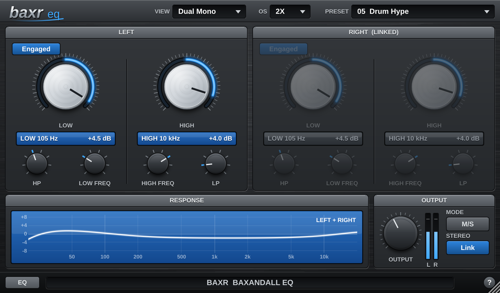

# BAXR

A stereo Baxandall-style mastering EQ plugin (VST3, Windows x64) built with JUCE 8. It uses
the same procedurally drawn GUI style as Virus Delay. The window is resizable, keeps its aspect
ratio and remembers its size. There is no licensing, copy protection or demo mode.



## Download

Every push to `main` builds the plugin on Windows, runs all the tests, and publishes
`BAXR-VST3-Windows-x64.zip` to the [`builds` branch](../../tree/builds). Unzip it and copy
`BAXR.vst3` to `C:\Program Files\Common Files\VST3\`.

## Controls

Each channel has the same set of controls:

| Control | Range |
|---|---|
| **Low** shelf gain | -5 .. +5 dB (0.5 dB steps when dragging, Shift = 0.1 dB, any value from automation) |
| **Low Freq** | 40, 75, 105, 150, 230, 300, 450, 600 Hz |
| **High** shelf gain | -5 .. +5 dB |
| **High Freq** | 1.5, 2.4, 3.5, 5, 7, 10, 14, 20 kHz (the label sits about an octave below the shelf's shoulder) |
| **HP** (12 dB/oct) | Off, 12, 18, 24, 36, 48, 72, 120 Hz |
| **LP** (12 dB/oct) | Off, 70, 50, 35, 24, 18, 12, 6.5 kHz |
| **Engage** | true bypass of that channel, with a 200 ms crossfade |

Global controls:

* **Output**: -10 .. +10 dB, with L/R peak meters.
* **M/S**: the two channels process Mid and Side instead of Left and Right.
* **Link**: in Dual Mono view, the second channel follows the first.
* **View**:
  * **Classic**: one control set for both channels.
  * **Classic Exp**: Classic plus the response display.
  * **Dual Mono**: two independent channels.
* **OS** (oversampling): 1X / 2X / 4X for the preamp stage.
* **Presets**: Init, Acoustic Guitar Control, Bass Bump 'n Tuck, Drum Driver, Drum Hype, Drum MS,
  Home HiFi, Mix Elixer, Pads Lift, Track Everything, Vocal Sheen, Zeroed Out 4X.

Knobs work the same way as in Virus Delay: drag or use the scroll wheel, hold Shift for fine
steps, double-click to reset, and hover to see the value.

### Host parameters (in this order)

1. HP_freq_left
2. LS_freq_left
3. LS_gain_left
4. HS_gain_left
5. HS_freq_left
6. LP_freq_left
7. HP_freq_right
8. LS_freq_right
9. reserved
10. reserved
11. LS_gain_right
12. HS_gain_right
13. HS_freq_right
14. LP_freq_right
15. Output
16. Engage_On/Off_left
17. Engage_On/Off_right
18. Mid_Side_on/off
19. Stereo_link
20. Oversampling (not automatable)
21. View (not automatable)

Frequency parameters use host values 0..1 in steps of 1/7. The shelf frequencies default to 0.5,
which selects the 5th position. Gain parameters put 0 dB at 0.5.

## Signal path

```
in -> L/R or M/S -> [HP -> low shelf -> high shelf -> LP] x 2 channels -> engage mix
   -> preamp (1X / 2X / 4X) -> DC block (2 Hz) -> output gain -> true-bypass crossfade -> out
```

* **Shelves**: first-order analogue Baxandall shelves, converted to digital with a matched pole and a
  numerator matched in magnitude at DC, Nyquist and a per-detent point. This avoids bilinear
  "cramping" near 20 kHz.
* **Low-pass**: matched poles plus a fitted correction section, so the 35/50/70 kHz corners stay
  correct at 44.1 kHz.
* **Preamp**: a gentle, slightly asymmetric soft saturation with unity small-signal gain. At 1 kHz it
  measures:

  | Level | H2 | H3 | Gain change |
  |---|---|---|---|
  | -18 dBFS | -63 dBc | -67 dBc | — |
  | 0 dBFS | -47 dBc | -31 dBc | -0.7 dB |

* **Oversampling**: linear-phase Kaiser half-band filters.
* **Latency**: 47 samples at every sample rate and every oversampling setting, so switching never
  changes the plugin delay compensation. Host bypass and Engage Off keep the same delay.
* **Precision**: everything runs in double precision, per sample. With the same settings, the output
  is bit-identical whatever the host block size.
* **Transitions**: shelf gains and output glide over 20 ms. Frequency, M/S and oversampling changes
  crossfade over 30 ms. Engage crossfades over 200 ms.

## Tests

Both test programs run in CI on every push. The plugin is published only if every check passes.

* `tests/EngineTests.cpp` runs 50 DSP checks with no JUCE dependency:
  * every detent and gain against the analogue prototypes, at 44.1, 48, 88.2, 96 and 192 kHz
  * latency at every rate and oversampling setting
  * bit-identical output across block sizes 1 to 4096, including random block sizes
  * click-free parameter changes
  * Engage Off gives a bit-exact delayed dry signal
  * M/S correctness, harmonics and aliasing, and digital silence in giving silence out
* `tests/PluginTests.cpp` runs 71 checks on the real processor and editor:
  * parameter order, names, defaults and display strings
  * float and double processing, latency, Output gain, presets, and state save/restore
  * editor views and resizing; it also renders the GUI to PNG

Results from this build:

| Check | Result |
|---|---|
| EQ vs analogue prototype, 20 Hz–20 kHz, at 44.1 / 48 kHz | ≤ 0.22 dB (worst case: 14 kHz shelf at +5 dB, near 18 kHz) |
| Same, at 88.2 kHz and above | ≤ 0.06 dB |
| Same, 20 kHz to 0.45 × sample rate | ≤ 0.42 dB |
| Engine level at -40 dBFS vs the EQ design | ≤ 0.001 dB |
| Alias of 15 kHz at 0 dBFS (sample rate 48 kHz) | -31 dBc at 1X, -118 dBc at 2X and 4X |

The VST3 itself was also loaded in a third-party VST3 host (pedalboard, on Linux). It reported
47 samples of latency and showed every parameter. The shelf boosts measured as designed: the left
channel's low shelf at +5 dB gave +4.76 dB at 50 Hz, with the right channel untouched. The output
was identical across host block sizes.

**Not done:** a null test against the original hardware-capture plugin. That needs the original
installed on a Windows machine. The frequency tables, shelf placement and preamp curve are design
values, not measurements of any other product.

## Building

The CI does this on Windows. To build locally you need CMake 3.22+ and Visual Studio 2022 (JUCE
8.0.4 is downloaded automatically):

```
cmake -B build -A x64 -DBAXR_BUILD_TESTS=ON
cmake --build build --config Release --target BAXR_VST3
```

The plugin is written to `build/BAXR_artefacts/Release/VST3/BAXR.vst3`.
